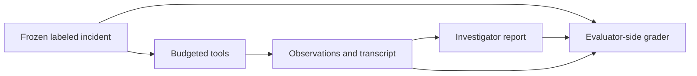

# InquestBench

**A working incident workbench and evaluation toolkit for microservice root-cause investigation.**

[Try the workbench](https://inquestbench.vercel.app) · [Benchmark card](docs/BENCHMARK_CARD.md) · [Tool API](docs/TOOLS.md) · [Grading](docs/GRADING.md) · [Frozen data](datasets/README.md) · [Related work](docs/RELATED_WORK.md) · [Roadmap](docs/ROADMAP.md) · [Release checklist](docs/RELEASE_CHECKLIST.md)

[Project progress](docs/PROGRESS.md) consolidates completed capabilities, reviewed experiments, known limitations and the next product milestone.

Investigate an incident across eight services: follow dependencies, inspect metrics and logs, compare recent changes, and submit a diagnosis. The browser demo works without an API key. The Python toolkit exposes the same incident data through budgeted tools and grades reports against evaluator-held labels.

**Status:** incident construction, the browser workbench, frozen loading, budgeted tools, and report grading work today. The recorded single-agent runner supports versioned policies, offline paired comparisons, and resumable model evaluations. V2 is the working evaluation baseline: it followed review of V1 failures and was frozen before authored-v2 was prepared. Both authored suites informed [V3](docs/POLICY_V3.md), which remains experimental. The CLI keeps V1 as its default to preserve existing invocation behavior; pass `--policy v2` explicitly for baseline runs. A fitted reasoner remains future work. This is an early evaluation toolkit, not a validated production benchmark.

## What you can run

| Component | Delivered behavior | Evidence |
|---|---|---|
| Browser workbench | Select a frozen or generated case; inspect telemetry; submit a diagnosis and reveal the answer | [App](app.py), [web tests](tests/test_web.py) |
| Saved-run viewer | Open a public two-episode walkthrough or local run folders; inspect exact-attempt observations, citations, reports, errors, and saved comparisons without model calls or uploads | [Viewer guide](docs/SAVED_RUNS.md), [browser tests](browser_tests/test_saved_runs.py) |
| Local browser execution | Start one offline investigation, inspect progress and budgets, cancel/resume, recover jobs and open saved results | [Local execution guide](docs/LOCAL_EXECUTION.md), [lifecycle tests](tests/test_local_jobs.py) |
| Incident generator | Eight fault categories, one root cause, 120 minutes of telemetry, JSON serialization | [Generator](src/inquest/scenario.py), [example](examples/generate_incident.py) |
| Frozen inputs | 120 smoke cases plus two separately versioned 16-case authored suites, provenance manifests and SHA-256 verification | [Data guide](datasets/README.md), [loader tests](tests/test_frozen.py) |
| Investigation environment | Eight read-only tools, charged attempts, observation IDs and detached transcripts | [Tool contract](docs/TOOLS.md), [environment tests](tests/test_env.py) |
| Agent runner | Strict JSON actions, Ollama/compatible adapters, offline heuristic, durable runs, resume, replay and per-budget summaries | [Runner guide](docs/RUNNER.md), [runner tests](tests/test_runner.py), [HTTP tests](tests/test_backends.py) |
| Report grader | Service, fault and fix checks; malformed-report handling; citation validation; Brier loss | [Grading contract](docs/GRADING.md), [grader tests](tests/test_grader.py) |

The investigation example uses five predetermined queries. The grading example uses two handcrafted reports. Neither is an autonomous-agent result or an accuracy claim.

## Quick start

Use Python 3.14 for the locally verified setup:

```bash
git clone https://github.com/Pranjal677504/Inquest.git
cd Inquest
python3.14 -m venv .venv
source .venv/bin/activate
python -m pip install -e ".[dev]"
python app.py
```

Open `http://127.0.0.1:8000`. On Windows, use `py -3.14 -m venv .venv` and `.venv\Scripts\Activate.ps1`; Windows execution has not been verified.

For saved investigations, open `http://127.0.0.1:8000/runs` and try the public sample, or choose a single run folder containing `run.json` and `episodes/`. Files stay in the browser tab; no API key or model request is needed. See [saved-run review](docs/SAVED_RUNS.md).

To **start investigations from the browser**, stop the previous server and run `python scripts/serve_local.py`, then open `http://127.0.0.1:8000/investigate`. This opt-in local service uses the free offline heuristic, durable SQLite job state, cancellation/recovery, and the existing saved-run viewer. Execution endpoints are absent from the public app. See [local execution](docs/LOCAL_EXECUTION.md).

For the Python examples and tests:

```bash
python examples/generate_incident.py
python examples/load_frozen_set.py
python examples/load_authored_set.py
python examples/inspect_incident.py
python examples/grade_report.py
python -m pytest -q
```

For Chromium workflow checks and their separate optional dependencies, see [Testing](docs/TESTING.md). These cover case switching, diagnosis, request failures, and keyboard navigation through the real Flask API.

**Dependencies:** the generator, loader, tools, and grader use the Python standard library. Installing the distribution also installs **Flask**, which runs the bundled web application. Tests use pytest. The browser workbench and offline heuristic require no model or provider key. Local browser execution uses Python's bundled SQLite, with no database server. Hosted model runs need a configured provider; local model runs need a model server and suitable compute.

**Python support and verification:** The [post-merge `main` CI run](https://github.com/Pranjal677504/Inquest/actions/runs/40069978593) passed the Python **3.10–3.14** matrix and Chromium browser workflows on Linux. The local-execution snapshot passed **473 Python tests and 17 Chromium browser workflows** locally. Manual macOS checks covered browser-started offline investigation, saved reports, tool observations, and result access after restarting the server. Package metadata requires Python 3.10+; Windows execution remains unverified. [CI](https://github.com/Pranjal677504/Inquest/actions/workflows/tests.yml) checks pull requests and updates to `main`. The hosted demo selects Python 3.14 in [`.python-version`](.python-version).

## Run a recorded investigation

```bash
python -m inquest run --suite datasets/authored-v1 --set holdout \
  --backend heuristic --budgets 5,10,20 --output runs/authored-baseline
```

This is a **non-LLM baseline**, not a model accuracy result. For Ollama, hosted-compatible endpoints, interruption/resume, and saved-run inspection, see the [Runner guide](docs/RUNNER.md). Actual model runs require a configured backend. The [recorded offline baseline](experiments/offline-baseline-v1/README.md) contains 96 episodes with complete traces and failure analysis; it is not an LLM experiment.

## A budgeted investigation

```python
from pathlib import Path
from inquest.env import InvestigationEnv
from inquest.frozen import load_frozen_set

# Evaluator-side setup: retain the labeled scenario outside the agent interface.
scenario = load_frozen_set(Path("datasets/smoke-v1"), "test-easy")[7]
env = InvestigationEnv(scenario, max_steps=5)

alerts = env.call("get_alerts")
print(alerts.id, alerts.text)
print("Steps remaining:", env.steps_left)
```

Available tools: `list_services`, `get_alerts`, `query_metric`, `search_logs`, `get_events`, `get_event`, `health_check`, and `get_trace`. Every attempted call consumes a step, including invalid requests. See [arguments, limits, and observation behavior](docs/TOOLS.md).

Reports name a service, fault type, fix action and target, observation IDs, and confidence. The additive `evidence_relevant_success` metric requires accepted success plus at least one citation matching the coarse gold tool/service labels. The [grader](docs/GRADING.md) separates diagnosis correctness from report validity. It rejects malformed confidence and invalid references rather than silently repairing them. Evidence relevance currently checks tool/service matches; it does **not** establish that the cited text supports a claim.



The browser is an unrestricted educational interface with answer reveal. Scored agents must use the budgeted observation interface, not the browser's case-selection metadata or diagnosis endpoint. Construction labels, seeds, scenario IDs, and gold metadata are excluded from tool observations. This boundary is not a sandbox against hostile Python code or memorization of public fixtures.

## Data and interpretation limits

[`inquest-smoke-v1`](datasets/README.md) contains 120 synthetic cases across `dev`, `test`, and `ood`, at three difficulties. Use `load_frozen_set` to verify and load the committed bytes. Do not regenerate comparison inputs from seeds: cross-version RNG equivalence is not guaranteed. Published suites are immutable; additions require a new version.

- The graph, eight fault categories, and handcrafted signatures are fixed. Recognizing those signatures can be easier than conducting an investigation.
- The `ood` split changes signal-log wording, not topology or failure mechanisms. It is not evidence of production generalization.
- The small public smoke suite is for interface checks, not sufficient likelihood training or strong performance claims.
- Gold tool/service relevance and fix action/target matches are coarse measures. Confidence scoring is implemented; calibration has not been demonstrated.
- [`inquest-authored-v1`](datasets/authored-v1/README.md) adds 16 separately constructed causal cases with explicit definitions, distractors, missing logs, and evaluator explanations. They are AI-authored and self-reviewed; independent domain-expert review remains pending. Access them through the Python loader and example.
- [`inquest-authored-v2`](datasets/authored-v2/README.md) adds 16 fresh mechanisms for the already-frozen V2 prompt, with five-call support/counterevidence paths and separate launcher outputs. The same author inspected earlier development results; this is not an independent or secret holdout. Report this suite separately.
- No fitted likelihood artifacts are published. The recorded offline heuristic is explicitly separate from model performance.

## Research direction and related work

Replayability is established practice in incident benchmarks. [Cloud-OpsBench, OpenRCA, AIOpsLab, ITBench, ORCA-bench, and OpenRCA 2.0](docs/RELATED_WORK.md) provide relevant prior work with stronger operational or causal coverage. Their results are not directly comparable with this small synthetic suite.

Inquest's proposed experiments ask whether **information-gain probe selection**, **confidence calibration**, and **success under equal investigation budgets** improve over simpler policies. Those are questions to test, not demonstrated advantages or claims of novelty. The [design notes](docs/DESIGN.md) explain the proposed belief model and its assumptions.

The [fresh-checkout release walkthrough](docs/releases/2026-10-25/README.md) passed for candidate `6eaa023`. The [benchmark card](docs/BENCHMARK_CARD.md) documents intended use, datasets, metrics and limitations. Next priorities are the changelog and versioned release, claim-level evidence support, and independently reviewed assessment cases. The saved-run viewer, public sample, and opt-in local execution are delivered. Interactive pairing of saved runs, topology variation, and a fitted reasoner remain future work. [Acceptance criteria and prerequisites](docs/ROADMAP.md) define the evidence needed before broader results can be claimed.

## Repository guide

| Path | Contents |
|---|---|
| [`src/inquest/`](src/inquest) | Generator, topology, frozen loader, tools, and grader |
| [`app.py`](app.py), [`public/`](public) | Flask API and browser assets |
| [`examples/`](examples) | Five runnable API demonstrations |
| [`tests/`](tests), [CI workflow](.github/workflows/tests.yml) | Behavior checks, data integrity, and Python compatibility |
| [`datasets/`](datasets) | Versioned frozen cases and provenance |
| [`docs/`](docs) | Contracts, design rationale, related work, roadmap, and dated verification |

## Development and ownership

This repository integrates and improves an existing local Inquest prototype. The [development log](docs/DEVELOPMENT_LOG.md) records actual changes and verification dates; the [design notes](docs/DESIGN.md) distinguish implemented decisions from proposed ones.

**Maintainer: Pranjal Prajapati.** The maintainer sets priorities, accepts design changes, reviews evidence, and decides releases. Contributions should include a focused reproduction, a reason for the change, and appropriate validation. Use [issues](https://github.com/Pranjal677504/Inquest/issues) to discuss independently authored cases, bugs, or evaluation improvements.

## License

[MIT](LICENSE).
